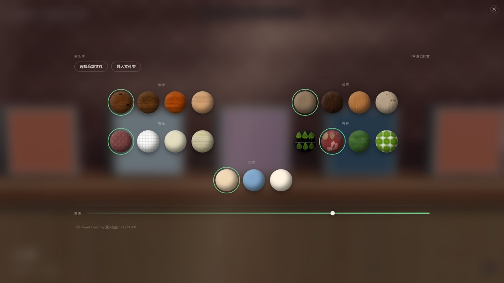
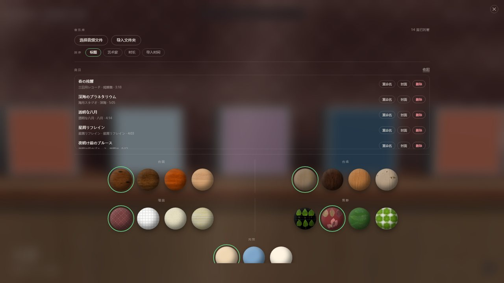
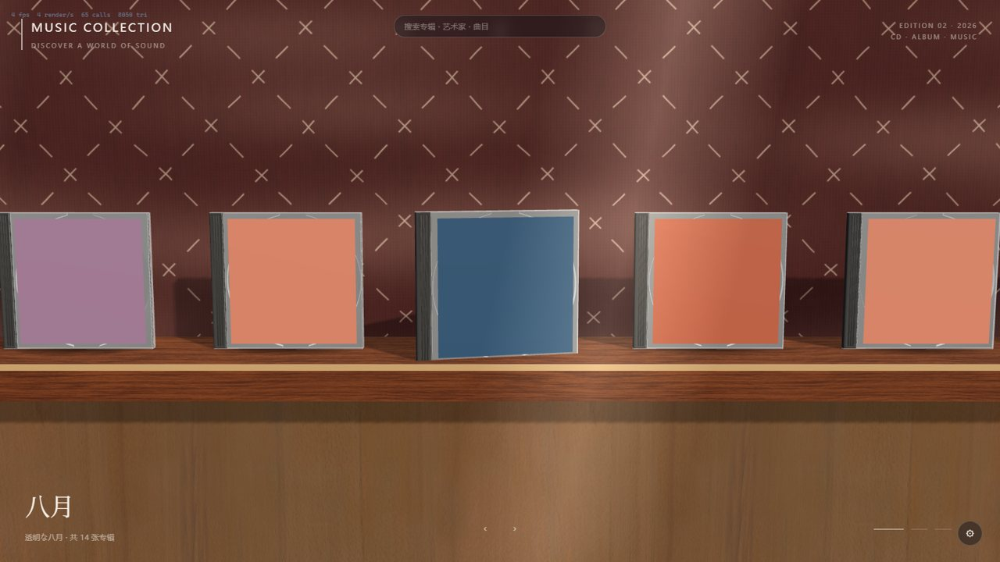
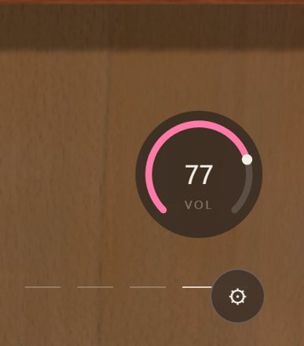

# 交接状态（2026-10-27 收口 · 第四轮）

## 这一阶段的成果

| 领域 | 状态 |
| --- | --- |
| 主界面 | 3D 画廊 + 详情 + 设置浮层；旧 rail / player-bar / 列表页 / 队列页 / 播放台、壁纸与主题页**已全部删除** |
| 顶栏 | 搜索框（标题/艺术家/专辑近似匹配）+ 结果浮层（最多 8 条，↑↓/Enter/Esc），点击飞到对应 CD |
| 设置 | 全透明浮层（Portal 到 body，z-index 9999）；音乐库导入 + **排序** + **曲目管理** + 材质球 + 音量 + 版权 |
| 曲库 | **软件托管**：导入即复制到 `userData/library/<artist>/<album>/<title>.<ext>`，`userData/library.json` 是唯一真源；三元组去重、封面进 `userData/covers`；支持排序 / 重命名 / 设封面 / 删除 |
| 播放 | 有当前曲目时右下角显示音量环（拖拽 / 滚轮 / 键盘，ARIA slider + 读数）；HTMLAudioElement 播放链路保留 |
| 场景预设 | `scenePreset { table, base, wall, silhouette, light }` 已写入 `settings.json`，台面 / 台底 / 墙面**实时驱动**；`silhouette` / `light` 目前只存不用（见技术债） |
| 持久化 | Electron 走 `settings.json`；网页预览走 `localStorage["arlt-hifi-settings"]` |
| 素材 | 16 套 2K 材质压缩为 48 个文件（10.8MB），按 `table/ base/ wall/ leaf/` 分类；`CREDITS.md` 已登记（CC0 + CC-BY） |
| CD 模型 | 合盖版 GLB 接入，封面按内页包围盒精确贴合；详情场景可开盖、盘片可拖出并限位 |
| 光效 | 丁达尔光束（6 片叠加软光条，漂移 + 呼吸）与流动光斑（150 个模糊圆斑，缓慢平移） |
| 阴影 | 已修复：墙面接收阴影、主光角度、台面投影、接触阴影（见下文记录） |
| 构建 | **Electron 主进程/preload 改 esbuild 打包**，修掉"应用一启动就崩"（之前 tsc 产物直接 import TS 源码） |
| 清理 | 删掉 10 个废弃组件、壁纸体系、不可达的播放台/扇开、shell.css 与死样式；CSS 46.4 KB → 22.9 KB |
| 门禁 | `pnpm typecheck` / `pnpm test`（101 + 11 + 6）/ `pnpm build` 全绿 |

## 阴影修复记录（第一轮）

### 根因（三个问题叠加，缺一不可）

1. **墙面不接收阴影**：`Shelf` 与 `BackWall` 的墙 mesh 都没有 `receiveShadow`，CD 的影子只能落在台面上。
2. **主光俯角过大**：原主光 `(3.6, 4.4, 2.4)` 的 `Ly / Lz = 1.83`，0.3m 远的墙面投影要下坠 0.55m；CD 高 1.04–1.56，影子整块落到 `y < 1.04`，正好被台面和 CD 自己挡住。看起来就像"阴影完全没生成"。
3. **台面不投影 + 环境光过亮**：台面只有 `receiveShadow`，所以台面前缘压到柜体的接触阴影根本不存在；`ambient 0.35 + hemisphere 0.2 + environmentIntensity 0.9` 又把本就微弱的投影洗平。

### 改动

- `gallery-stage.tsx`：墙加 `receiveShadow`、台面加 `castShadow`；主光改 `(2.8, 3.6, 3.4)`、强度 2.4、`mapSize 2048`、`bias -0.0003`、`normalBias 0.018`；`ambient 0.12` / `hemisphere 0.12` / `environmentIntensity 0.4`。
- `contact-shadows.tsx`（新增）：径向渐变黑色贴图当 `map`（不要用 `alphaMap`——three 的 alphaMap 取绿通道，canvas 透明渐变会退化成常量），每个 `Disc` 一片 0.68 × 0.3 的贴地平面，台面上方 1.5mm，`opacity 0.62`、`depthWrite: false`。

### 验证

- 对比图：[`shadow-before.jpg`](shadow-before.jpg) → [`shadow-after.jpg`](shadow-after.jpg)。
- 目视：CD 左后方墙面软投影、台面/柜体接触阴影、CD 底部贴地；画廊 64 calls / 8048 tri。

## 音乐导入与托管（第二轮，刀 3）



### 数据模型

- 托管目录：`userData/library/<artist>/<album>/<title>.<ext>`（只复制受支持格式：flac/wav/mp3/m4a/ogg，原文件不动）。
- 曲库清单：`userData/library.json`，`{ version: 1, entries: [{ track, size, headSha1, importedAt }] }`。**manifest 是唯一真源**，启动时读它，并顺手剔除已被手工删掉的文件。
- 去重三元组：`(文件大小, 时长, 前 256KB SHA-1)`；先比大小+时长，命中候选才读头部算哈希，避免几百 MB 母带整份哈希。
- 命名清洗：Windows 非法字符 `<>:"/\|?*` 与控制字符 → `_`，去掉尾部点/空格，单段 ≤ 80 字符；同名不覆盖，自动 ` (2)`、` (3)`。
- 封面沿用 `userData/covers/`，按托管后的路径哈希命名（同一首重复导入不会产生新封面文件）。

### IPC / 渲染进程

| 通道 | 行为 |
| --- | --- |
| `library:select-files` | 系统多选文件对话框（带音频过滤器），只选不复制 |
| `library:import-files` | 按路径复制入库，返回 `{ imported, skipped }` |
| `library:import-folder` | 目录对话框 + 递归收集受支持格式后导入，返回 `{ canceled, imported, skipped }` |
| `library:load` | 读 manifest 并返回曲目（同时刷新媒体协议白名单） |
| `library:import-progress` | 每处理完一个文件推一次 `{ completed, total }` |

- preload 新增 `selectAudioFiles` / `importAudioFiles` / `importAudioFolder` / `loadLibrary` / `onLibraryImportProgress`（返回取消订阅函数）。
- 导入完成后主进程立刻把新音频与封面加入媒体协议白名单（`addAudioFilePaths` / `addImageFilePaths`），不用重启即可播放。
- 渲染进程 `useLibraryImport` 负责对话框 → 导入 → 重新 `loadLibrary` → 重建队列 → 结果文案（导入 N 首 / 已存在 X 首 / 格式不支持 X 首 / 失败 X 首）。
- 设置浮层「音乐库」区：已托管数量 + 「选择音频文件」「导入文件夹」+ 进度（`正在导入 3/10`）与红色错误文案。
- 空曲库时画廊文案改为「曲库为空 · 右下角设置里可导入音乐」。
- **移除旧目录模型**：`select-music-directory` / `scan-music-directory` / `AppSettings.musicDirectory` / App 的目录扫描状态全部删除；网页预览点击导入会提示「请使用 Electron 桌面应用」。

### 构建链路修复（不修则应用无法启动）

- 现象：`electron .` 直接报 `ERR_UNKNOWN_FILE_EXTENSION ".ts"`。原因：主进程 `import "@arlhifi/shared"`，而该包 `exports` 指向 TS 源码，之前的 tsc 产物没有打包，Node 运行时无法加载。
- 另外 preload 编译成 ESM，而沙箱 preload 不支持 ESM import。
- 新增 `apps/desktop/scripts/build-electron.mjs`（esbuild）：
  - `electron/main.ts` → `main.js`（ESM、bundle、external 只有 `electron`；banner 注入 `createRequire`，供依赖里的 CJS 动态 `require("tty")` 使用）；
  - `electron/preload.ts` → `preload.cjs`（CJS，匹配沙箱 preload 限制）。
- `dev-electron.mjs` 改用同一打包脚本；`package.json` build 去掉 tsc emit、增加 esbuild devDependency；删除 `tsconfig.electron-build.json` / `tsconfig.electron-dev.json`。

### 验证

- 单测（真实临时目录 + 真实 WAV）：
  - `library-import.test.ts` 12 项：复制到 artist/album、进度回调、三元组去重（改名仍算重复）、同名 ` (2)` 不覆盖、不支持/不可读文件不中断批次、头部哈希只读 256KB。
  - `library-manifest.test.ts` 5 项：损坏 manifest 当空库、丢弃畸形条目、落盘回读、剔除被删文件。
  - `music-scanner.test.ts` 新增递归收集与大小写扩展名用例；修正 `createTrackFromFilePath` 对 `.FLAC` 的标题截断 bug。
- 网页预览截图：音乐库区、「14 首已托管」、两个按钮；点击后出现红色提示。
- **未验证**：真实 Electron 窗口里的文件对话框、IPC 导入、媒体协议播放。本机 Electron 创建窗口即 `0xC0000005` 崩溃（最小 `new BrowserWindow` 同样崩），属于当前 DSH 会话环境限制；需要在真实桌面会话跑 `pnpm dev` 复验。

## 管理音乐 + 搜索飞行 + 音量环（第三轮，刀 4）



### 排序

- `AppSettings.librarySort: "title" | "artist" | "duration" | "imported"`，写进 `settings.json`，默认 `title`。
- `sortTracks`（曲目列表）与 `groupTracksForGallery(tracks, sortKey)`（画廊槽位）共用同一套 key；`imported` 直接保留 manifest 顺序。
- 画廊与设置里的曲目列表都会跟着排序；槽位还带 `durationSeconds`（整张专辑总时长）与 `order`（首次出现位置）。

### 管理（只动副本）

| 操作 | 行为 |
| --- | --- |
| 重命名 | `library:rename-track`：清洗标题 → 同目录改副本文件名（重名自动 ` (2)`）→ 更新 manifest 的 title/filePath；**id 保持不变**，收藏与队列不受影响 |
| 设封面 | `library:set-track-cover`：图片复制到 `covers/override-<id hash>-<时间戳>.<ext>`，删除旧的自定义封面（标签提取的封面不动） |
| 删除 | `library:delete-track`：删副本 + 自定义封面 + manifest 条目；渲染进程二次确认（第一次点「删除」变成「确认删除」） |

- 渲染进程 `useLibraryManage` 统一处理忙碌态/错误文案，成功后重新 `loadLibrary()`；每次变更后主进程重设媒体协议白名单。
- 设置浮层「曲目」区：默认折叠，展开后是滚动列表（标题/艺人·专辑·时长 + 重命名/封面/删除）；重命名是行内输入框（Enter 保存 / Esc 取消）。

### 搜索飞行

- 搜索**不再过滤画廊**：输入后在搜索框下方列出最多 8 条结果（标题 + 艺人·专辑），↑↓ 换选中项、Enter 飞、Esc 清空；点击结果同样触发。
- 飞行 = 把目标槽位滑到正中（循环时走最短方向，不改相机）；落地后该 CD 抽出 2.2 秒（前推 0.16、旋转 0.24、缩放 1.06）。
- 在详情/播放层级里搜索也会先回到画廊再飞行（`focusGroupId + focusNonce` 驱动）。
- 无障碍：输入框 `role="combobox"` + `aria-expanded/aria-controls/aria-activedescendant`，列表 `role="listbox"` / `option`。



### 音量环

- `components/volume-ring.tsx`：270° SVG 仪表，指针拖拽（角度映射 0–100）、滚轮 ±5、方向键 ±5（Shift ±10）、Home/End。
- `role="slider"` + `aria-valuemin/max/now/valuetext`，中心数值读数；连按用 ref 取最新值，避免同一帧内多次事件丢步。
- 只要存在当前曲目就显示（详情场景里开始播放后也能直接调）；`stage === "player"` 目前不可达，见技术债。



### 验证

- 单测：`library-manage.test.ts` 8 项（改名/重名避让/非法字符清洗、封面复制与旧覆盖删除、删除副本与条目）、`album-groups.test.ts` 增加 artist/imported/时长用例、`library-filter.test.ts` 增加 imported 排序。
- 网页预览：设置浮层排序 + 管理列表 + 行内重命名 + 二次确认；搜索浮层、点击后目标 CD 居中并抽出；音量环键盘 72→82、滚轮 82→77；排序切换后画廊首张从「八月」变为「静かな星」。
- **未验证**：Electron 窗口里的原生文件对话框、IPC 改名/换封面/删除。本机 Electron 仍无法创建窗口（`0xC0000005`），需在真实桌面会话跑 `pnpm dev` 复验。

## 清理与门禁（第四轮，刀 5）

### 删除

- **渲染层组件**：`app-rail`、`player-bar`、`queue-page`、`library-page`、`settings-page`、`track-row`、`cover-art`、`empty-state`、`vinyl-record`、`background-scene`。
- **壁纸体系**（ADR-006 决策 2 已把壁纸并入场景预设）：`wallpaper-store`、设置里的 `backgroundImagePath / wallpaperBlur / wallpaperDim`、`selectBackgroundImage` IPC、`createBackgroundMediaUrl` / `BackgroundImageSelectionResult`、`fixtures/themes`。
- **场景死代码**：`Fan`（扇开）、`PlayerStage`（播放台）、`stage` / `expandedGroup` 状态与对应 DOM（展开遮罩、播放控制条）、`Disc` 的 `isFavorite` / `scale` / `spinning`、`favoriteGroupIds` 整条 prop 链、未使用的 three 导入与 `DISC_RADIUS`。
- **其他**：`audio-controller`（seek 只有死播放栏在用）、`shell.css`（25 KB，133 个类没有一个活页面在用）、`base.css` 的 `.spin`、`scene.css` 里 17 个死类、`demo-params` 的 4 个死 helper、`HifiSignalInfo` 类型、墙面/柜体/台面只加载不使用的 normal map。
- **顺带修复**：详情页返回按钮原来压在左上 `MUSIC COLLECTION` 上（两者都在 top-left），下移到 `top: 96px`。

### 保留（有意为之）

- `favorites` 仍在 store / `settings.json` 里（收藏外观与切换入口还没做），只是不再有死 prop 链。
- `packages/ui` 的 Button / Knob 等组件当前没有调用方，但 token 样式 `@arlhifi/ui/styles.css` 仍被使用，包整体保留。
- `shared` 的 `formatSampleRate / formatBitDepth / getQualityLabel` 等格式化函数暂时没有 UI 调用方，保留为后续信号展示的公共 API。
- theme / motion 设置仍会写到 `<html data-theme/data-motion>`，由 `@arlhifi/ui` 的样式消费。

### 验证

- `pnpm typecheck`、`pnpm test`（101 + 11 + 6）、`pnpm build` 全绿；`tsc --noUnusedLocals --noUnusedParameters` 对渲染层与 electron 配置均无输出。
- 清理后画廊仍是 64 calls / 8048 tri；详情场景 17 calls / 2768 tri；设置浮层的音乐库 / 排序 / 管理 / 材质 / 音量均正常；CSS 产物 46.4 KB → 22.9 KB。

## 未解决

### 1. 技术债

- **重命名没有写标签**：只改了副本文件名和 manifest 里的 title（`music-metadata` 只读，没有引入 tag writer）。重新导入同一个源文件会带回旧标签。
- 重命名正在播放的曲目时，`currentTrack` 仍按 id 保留旧对象（文件路径已变）；极端情况下暂停/恢复可能读不到文件。
- 搜索行为是"结果浮层 + 飞行"（按 ADR-006 决策 3），不再过滤画廊；如果还想要过滤需要另做开关。
- 设置浮层内容较长（音乐库 + 排序 + 管理 + 材质 + 音量），小窗口下需要滚动；后续可把"管理"拆成独立面板。
- 导入在**批末**写 manifest：中途崩溃/断电会留下孤儿副本，再次导入同名文件会变成 ` (2)`；如需更强一致性，可每成功一首就落盘或先写临时清单。
- 曲库没有「刷新/监听文件变化」：手工往 `userData/library` 放文件不会被发现；删文件只在下次 `library:load` 时剔除。
- 导入是串行逐文件处理，没有取消；几百首的文件夹会占用 UI（有进度但没有停止按钮）。
- 设置面板「剪影」「光效」两组材质球**没有任何代码消费**（`scenePreset.silhouette` / `.light` 只写入 `settings.json`）；要么接回场景，要么删掉这两组（连同 4 套 leaf 贴图）。
- `gallery-stage.tsx` 仍有 600+ 行，混了相机、货架、CD、详情、光效、搜索飞行、音量环，建议拆 `scene/shelf.tsx`、`scene/carousel.tsx`、`scene/stage.tsx`。
- 详情场景的盘片自转仍缺（转动整个 `CD_1` 会让盘片侧翻，需要单独转 `Object_13` 的局部法线轴）。
- 网页预览的 `localStorage` 与 Electron 的 `settings.json` 是两套存储，字段变更时要同步 `mergeSettings`；且 demo API 存在时 `useSaveSettings` 走 demo 的 `saveSettings`，preview 实际不写 localStorage。
- `?merge=1` 的网格合并路径保留但默认关闭，未验证收益。
- 收藏（favorites）没有切换入口与外观；store / 设置里的数据目前只能被动保存。
- `electron-builder` 打包从未实际执行；本机 Electron 窗口也无法创建，窗口级验证仍待真实桌面。
- `packages/ui` 的组件与 `shared` 的部分格式化函数暂无调用方（见"保留"）。

### 2. 后续方向

原始五刀已全部完成。接下来优先考虑：

1. 标签写入（重命名同步 tag），需要引入 tag writer 或按格式手写。
2. 曲库刷新/监听、导入取消与断点续传。
3. 收藏的切换入口与金边外观（ADR-005 §6）。
4. 键盘可达性与无 WebGL 时的降级视图。
5. 组件级测试、Electron 打包冒烟与真机帧率验证。

## 验收命令

```powershell
pnpm typecheck          # 三个 tsconfig 全绿
pnpm test               # desktop 101 + shared 11 + harness 6
pnpm build              # esbuild 打包 main/preload + vite 打包 dist
pnpm dev:web            # http://localhost:5173/?demo=1&perf=1
pnpm dev                # Vite + Electron（需真实桌面会话）
```

本机环境提示（DSH 沙箱下）：

- `pnpm typecheck/test/build`、`vite`、Chrome、Electron 都需要 `danger-full-access`，否则子进程 `spawn EPERM`。
- 编辑器的原子保存会在源码目录生成 `.xxx.tmpdir` 临时目录，Vite 的 `fs.watch` 会 `EBUSY` 崩溃；用 `$env:CHOKIDAR_USEPOLLING='1'` 启动。
- `pnpm build` 需要把 `$env:TEMP` / `$env:TMP` 指到工作区内，否则 esbuild 删除系统临时文件被沙箱拒绝。
- DSH 环境自带 `ELECTRON_RUN_AS_NODE=1`：启动 Electron 前必须 `Remove-Item Env:ELECTRON_RUN_AS_NODE`，否则 Electron 会当纯 Node 跑。
- 本机 Electron 窗口创建即崩（access violation），headless Chrome 正常；截图脚本可临时放 `.tmp-browser/shot.mjs`（Node 内置 WebSocket 直连 CDP），用完删掉。
