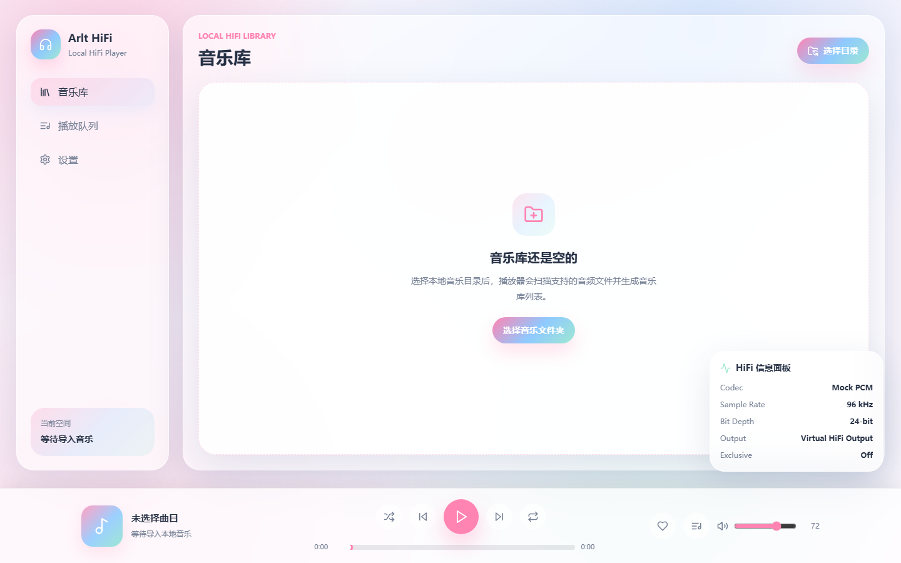

# Arlt HiFi Player — v1.0 重建工作流

> 本文档定义"把半成品做成成品"的执行流程、阶段门禁和验证手段。所有阶段产出都必须可验证、可回退，并且不越过 AGENTS.md 的硬约束。

## 0. 基线（S0 已完成）

### 已具备的能力

- pnpm workspace + Electron + React + TypeScript strict + Vite + Zustand + Tailwind。
- 主进程能力：目录选择、递归扫描（flac/wav/mp3/m4a/ogg）、受控媒体协议 `arlt-hifi-media://`。
- preload 暴露 `selectMusicDirectory` / `scanMusicDirectory`，渲染层不直接访问 Node。
- 播放 MVP：`HTMLAudioElement`，播放/暂停/上一首/下一首/进度同步/错误态。
- 文档体系：vision / mvp / roadmap / design-language / ADR / prompts / evals / checklists。

### 基线界面（改造前）

### 基线校验结果（本次实测）

| 命令 | 结果 |
| --- | --- |
| `pnpm typecheck` | 通过（4 个包） |
| `pnpm test` | 通过（17 个用例，4 个测试文件） |
| `pnpm build` | 通过（dist 产物 164.98 kB JS / 17.49 kB CSS） |

> 附带修复：项目从 `F:\HiFi player` 迁移到当前路径后 `node_modules` 全部变成本地失效链接，已用本地 pnpm store 重装（`electron` 二进制需手动补装）。这是环境问题，与代码无关，但会阻塞一切验证。

### 已确认缺陷清单

| 编号 | 级别 | 问题 | 影响 |
| --- | --- | --- | --- |
| P0-1 | P0 | `vite build` 使用 `base: "/"`，`dist/index.html` 引用 `/assets/...`；主进程用 `loadFile` 加载 | 生产构建必然白屏 |
| P0-2 | P0 | `package.json` 的 `main` 指向从未生成的 `dist-electron/`，`build` 只产出渲染层 | 无法启动生产版，更无法打包 |
| P0-3 | P0 | 开发脚本未清理 `ELECTRON_RUN_AS_NODE` | 该变量泄漏时 `pnpm dev` 只跑 node 不弹窗 |
| P1-1 | P1 | HiFi 信息面板 `position: fixed` 浮在内容之上 | 遮挡列表末行，违反 design-language「不遮挡核心操作」 |
| P1-2 | P1 | 死控件：随机、循环、收藏、播放列表、三个导航项 | 交互承诺与实际不符 |
| P1-3 | P1 | 进度条不可拖动、无 seek | 播放器基本能力缺失 |
| P1-4 | P1 | HiFi 面板恒显 mock 数据（96 kHz / 24-bit / Virtual HiFi Output） | 伪造信号信息，违背「HiFi 可见但边界诚实」 |
| P1-5 | P1 | 不存在真实队列：`queue` 恒等于 `library`，无播放模式 | 队列页无从谈起 |
| P1-6 | P1 | 无搜索/排序；重启后丢失目录与曲库 | 长期使用体验断裂 |
| P1-7 | P1 | `.dev-electron/**` 构建产物被 vitest 收集，重复跑同一测试 | 测试信号失真 |
| P1-8 | P1 | 仓库没有 `.git` | 无法做原子提交与回滚，流程不可追溯 |
| P2-1 | P2 | 元数据只有文件名推断，质量字段对 flac/wav 硬编码 44100/16 | 信息不可信（需要在 UI 上显式标注） |
| P2-2 | P2 | 主题 token 有 light/dark 两套，但没有任何入口切换 | 半成品状态 |

## 1. 成品定义（Definition of Done）

成品 = 一个能装、能扫、能放、信息可信、界面克制的本地 HiFi 桌面播放器。用户视角必须能完成这条闭环：

1. 启动应用，看到稳定的主界面（不白屏、不遮挡）。
2. 选择本地音乐文件夹，扫描结果与错误都有明确反馈。
3. 在音乐库中搜索、排序、播放任意曲目。
4. 在播放栏完成播放/暂停/上一首/下一首/拖动进度/调音量/静音。
5. 播放模式（顺序 / 单曲循环 / 随机）真实生效，队列可见、可跳转、可移除。
6. 看清当前曲目的真实格式信息，并明确区分"来自文件名推断"与"audio-core 未接入"。
7. 退出重进，上次目录、设置、音量仍在。
8. 生产构建能启动（`pnpm start`），并能产出可分发包。
9. `pnpm typecheck` / `pnpm test` / `pnpm build` 全绿，文档与代码一致。

## 2. 范围边界（不越界）

**做**

- 重构渲染层信息架构与设计系统（三页：音乐库 / 播放队列 / 设置）。
- 重构 `player-store` 为可测的纯领域逻辑 + 真实队列 + 播放模式。
- 补齐播放交互（seek、静音、模式、自动下一首、错误恢复）。
- 库的搜索/排序/刷新/持久化（单目录）。
- HiFi 信息诚实化（真实 / 推断 / 未接入三态）。
- 生产构建与打包链路修复。
- 测试补齐、CI 拉齐、文档同步。

**不做（记录在 [backlog](backlog.md)，不实施）**

- Rust audio-core、真实解码、输出设备枚举、独占模式、ASIO/WASAPI。
- 标签（ID3/Vorbis）解析与封面提取——仍按文件名推断展示，并显式标注。
- 右侧舞台、角色舞台、Live2D、MV、动态视觉舞台、歌词滚动。
- 多目录、在线流媒体、云同步、自动更新、账号体系。
- 引入新的状态库、UI 框架、CSS-in-JS 或路由库。

## 3. 阶段工作流

每一阶段都必须走完「验收标准 → 实现 → 质量门禁 → 截图/运行验证 → 文档同步 → 提交」后才允许进入下一阶段。**门禁不绿不进入下一阶段。**

### S1 需求与信息架构冻结

- 交付物：更新的 `docs/product/mvp.md`（验收标准表）、`docs/product/design-language.md`（布局与控件规则）、`docs/decisions/003-v1-scope.md`。
- 关键决策：三页 IA、播放模式语义、HiFi 信息位置（数据列，非舞台）。
- 验收：每条验收标准都能映射到后续阶段的实现项或测试用例。
- 验证：文档交叉检查（vision / mvp / roadmap / design-language 无互相矛盾）。

### S2 设计系统与界面骨架

- 交付物：tokens 重做（色彩/间距/字号/圆角/阴影/动效时长）、`packages/ui` 基础组件（`Button` / `IconButton` / `Panel` / `Field` / `Slider` / `SegmentedControl` / `EmptyState`）、三页布局骨架。
- 方向：安静、克制、可长期注视的"仪器面板"感；无糖果渐变、无发光按钮、无遮挡式浮层。
- 验收：1440×900 与 1024×680 两档截图无遮挡、无溢出；键盘可达（focus 可见）；对比度达标。
- 验证：构建后静态服务 + headless 截图对比两个视口。

### S2R 场景展厅（新增，ADR 005）

原 S2 的系统层成果保留（列表、队列、设置、播放栏继续作为系统层与降级视图），3D **CD 长廊**作为库的主视图插入。规格见 [场景展厅规格](../product/scene-gallery.md)。

#### S2R-0 场景技术 spike

- 交付物：`three` + `@react-three/fiber` 接入、`src/scene/` 骨架、单张 CD 可旋转、**60 张 CD 的长廊压测场景**、开发模式帧率 HUD、WebGL 不可用时的降级入口。
- 验收：1280×820 下 ≥ 45fps（60 张 CD 同屏）；静止 800ms 后渲染计数归零；禁用 WebGL 时不白屏。
- 验证：帧率 HUD 读数 + 截图 + `pnpm build` 体积对比。
- 止损点：目标机器上无法稳定 45fps 时，先砍景深/接触阴影；仍不达标则退回 CSS 3D 或静态方案，并回写 ADR。

**S2R-0 结论（2026-10-24 实测，headless Chromium 1280×820）**

| 场景 | FPS | Draw calls | 三角形 |
| --- | --- | --- | --- |
| 60 张 CD（3 段 Bay，巡游） | 56 | 23 | 12,479 |
| 240 张 CD（10 段 Bay，巡游，未虚拟化） | 42 | 79 | 49,862 |
| 静止（800ms 无交互） | — | — | 渲染帧数归零 ✓ |

- 主包体积不变（205 kB / 66.9 kB gzip）；three + R3F 全部落在懒加载 chunk（820 kB / **220.9 kB gzip**）。
- **关键发现**：draw call 增长来自架子（每段 6 个 mesh），不是 CD（实例化后恒定 3 个）。240 张时 79 个调用里约 60 个是架子。
- **结论修正（S2R-1a 后）**：架子确实是 draw call 的主要来源，但**不是帧率瓶颈**——把调用从 79 降到 13、三角形从 49.9k 降到 10k 后，headless 帧率几乎不变（42→44）。headless Chromium 的帧率受填充率与调度噪声支配，**不能作为 GPU 性能的代理**；45fps 目标必须在真机验证。
- 未验证项：Electron 内实测帧率（沙箱无法截取窗口），需真机跑 `ARLT_DEV_QUERY="?scene=1&spin=1" pnpm dev` 读 HUD。

#### S2R-1 长廊与生长

- 交付物：`getGalleryAnchor` / `getBayCount` 纯函数、Bay 空间模型（24 位/Bay、左右交替、4 层）、生长与消退动画、写实材质（PBR + 程序化环境光）、实例化与 Bay 虚拟化。
- 验收：曲库 0/1/23/24/25/47/48 首时空间正确；增长时新 Bay 升起并点灯，缩减时消退；常驻 Bay ≤ 5。
- 验证：单测（边界）+ 时间轴截图 + 帧率/显存读数。

**S2R-1a 性能与虚拟化（已完成，2026-10-24）**

- 架子改为全局实例化（2 个 `InstancedMesh` 覆盖所有 Bay），CD 按 Bay 分组、只挂载相机 ±2 段，盘面 48→28 段，加入程序化 `RoomEnvironment` + PMREM 环境光（纹理数 2，盘面终于有金属反射）。
- 实测：**240 张 → 13 draw calls / 9,982 三角形 / 挂载 3/10 Bay；500 张 → 13 / 10,958 / 3/21**。draw call 与曲库规模彻底解耦。
- 修正结论：帧率没有随绘制成本改善，说明 headless 受填充率与噪声支配，**不能用来判 GPU 性能**；真机验证仍是唯一口径。
- 遗留：growth/消退动画、封面纹理池、hover 与点击命中（S2R-1b）。

#### S2R-2 长廊交互

- 交付物：拖拽平移、滚轮推进、双击回位、hover 标签、点击命中、跨 Bay 两段式移动、搜索飞行、收藏外观（金边/三角标记）。
- 验收：三种移动方式手感一致；远处跳转不眩晕、不长时间黑屏；收藏 CD 三 Bay 外可辨。
- 验证：手测清单 + 录屏 + 截图。

#### S2R-3 转场与播放台

- 交付物：750ms 转场、播放台悬浮 CD（鼠标倾斜 ±12°、播放转动 6s/圈、暂停缓停）、控制层与信号信息叠加、返回动画。
- 验收：转场不丢帧；`motion=off` 时直接切换；控制层可聚焦且不被遮挡。
- 验证：帧率采样 + 截图 + 键盘走查。

#### S2R-4 降级与可达性

- 交付物：列表视图接管（`L` 键与设置项）、ARIA live 播报、低帧率自动降级、`motion=off` 静态场景、DOM 按钮叠加层（仅覆盖可见 Bay）。
- 验收：完成 [场景展厅规格 §11](../product/scene-gallery.md) 中 G11–G13；同时回归系统层遗留未勾选的验收项。
- 验证：禁用 WebGL 启动、系统开启"减少动态效果"、纯键盘操作。

#### S2R-5 打磨

- 交付物：景深、接触阴影、生长时序、盘面衍射、首帧与转场微调。
- 验收：G8/G10 稳定达标；视觉截图通过评审。
- 验证：三档截图 + 连续 60 秒帧率采样。

### S3 领域模型与状态重构

- 交付物：`types.ts` 扩展（`MediaFormat`、`PlaybackMode`、`QueueEntry`）、`player-store` 拆分为 library / queue / playback / settings 语义（仍单 store，按 slice 组织）、纯函数抽取到可单测模块。
- 验收：队列与库解耦；上一首/下一首/模式切换/移除当前曲目都有确定行为与单测。
- 验证：`pnpm test`（store 用例覆盖所有状态迁移）。

### S4 播放链路

- 交付物：`use-audio-playback` 重构（seek、音量、静音、`ended` 策略、模式、错误恢复）、播放栏重构。
- 验收：拖动进度生效；暂停后恢复位置；换曲不残留旧进度；错误态有可恢复操作；不引入任何 Node/Electron 直接访问。
- 验证：单测（hook 逻辑抽取为纯函数）+ 真机 Electron 手测清单。

### S5 库、扫描与持久化

- 交付物：扫描结果分级（`flac/wav → lossless`，`mp3/m4a/ogg → lossy/unknown`，采样率位深未知时标 `—`）、搜索、排序（标题/艺术家/时长/格式）、刷新、上次目录持久化（主进程 `app.getPath("userData")`，通过 preload 暴露）。
- 验收：重启恢复目录；搜索/排序结果可预期；空目录、无权限、超大目录都有状态。
- 验证：scanner 单测 + 真机手测。

### S6 HiFi 信息诚实化

- 交付物：HiFi 信息与曲目绑定，字段来源标注（`来自扩展名` / `来自文件名` / `未接入 audio-core`）；移除 `mockHifiSignalInfo`。
- 验收：任何一屏都不出现无法解释的数值；未接入项明确写"未接入"。
- 验证：快照/单测断言三态渲染 + 截图核对。

### S7 生产可用与打包

- 交付物：`vite base: "./"`、主进程产物 `dist-electron`、`pnpm start` 运行生产构建、`.dev-electron`/`dist` 与 vitest 隔离、`ELECTRON_RUN_AS_NODE` 清理、`electron-builder` 免安装包（如确认纳入）。
- 验收：`pnpm build && pnpm start` 打开窗口且界面正常；安装包能生成并启动。
- 验证：真机启动 + 生产构建截图与开发态一致。

### S8 质量门禁与文档收尾

- 交付物：测试覆盖率补齐（store/scanner/format/queue/seek）、CI 增加 build 与排除构建产物、README 与 roadmap 状态更新、ADR 归档、`docs/evals/eval-plan.md` 对齐。
- 验收：三条命令全绿；文档无过期描述；`git log` 呈现清晰的阶段提交。
- 验证：清空 `node_modules` 后 `pnpm install && pnpm typecheck && pnpm test && pnpm build` 全流程复现。

## 4. 每阶段执行循环

1. **写验收标准**：先写成可判定的句子（"拖动进度条到 50% 后 1 秒内位置误差 < 1s"）。
2. **先失败后修复**：能写测试的先补测试（红），再实现（绿）。
3. **最小实现**：只改达成该条验收所需的代码，无关问题记入 backlog。
4. **质量门禁**：`pnpm typecheck` → `pnpm test` → `pnpm build`。
5. **可视化验证**：截图或真机运行，与上一步验收标准逐条对照。
6. **文档同步 + 原子提交**：一次提交只表达一个意图。

## 5. 验证手段

| 手段 | 命令 / 方式 | 说明 |
| --- | --- | --- |
| 类型 | `pnpm typecheck` | 必须 0 错误 |
| 单测 | `pnpm test` | 新增行为必须有对应用例 |
| 构建 | `pnpm build` | 渲染层 + 主进程产物都要生成 |
| 生产运行 | `pnpm start` | 打开生产构建窗口 |
| 真机开发 | `pnpm dev` | 需确保 `ELECTRON_RUN_AS_NODE` 未泄漏 |
| 渲染层截图 | 本地静态服务 + Chrome `--headless --screenshot` | 用于设计核对与回归对比 |
| 渲染层预览 | `pnpm dev:web` + `?demo=1&track=1&page=queue&theme=light` | 开发模式注入示例曲库（`src/dev/`），生产包不含该代码 |
| CDP 截图 | `.verify/tools/capture.mjs <url> <out.png> [w] [h]` | 等待渲染完成后截图并回显页面控制台错误 |
| 场景帧率 | 场景内 HUD（`?scene=1` 自动显示） | 读数 ≥ 45fps；静止 800ms 后渲染计数归零 |
| 场景压测 | `ARLT_DEV_QUERY="?scene=1&spin=1" pnpm dev`，或浏览器 `?scene=1&spin=1&tracks=240` | `spin=1` 让镜头持续巡游，fps 才有意义；`tracks=N` 压测更长长廊 |
| WebGL 降级 | 启动参数 `--disable-gpu --disable-webgl` | 断言自动进入列表视图且功能完整 |
| 减少动效 | 系统设置或 `?motion=off` | 断言无位移动画、场景冻结为静态 |
| 手工验收 | 按 S4/S5 的交互清单逐条点 | 播放、seek、模式、持久化 |

> 环境说明：当前会话的沙箱禁止子进程通过管道通信，`vitest`（esbuild）与 Chromium 多进程都需要放宽权限才能运行；截图与测试命令需要单次提权。此限制只影响本会话，不影响项目本身的规范命令。

## 6. 变更控制

- 任何超出本文档范围的想法 → 写入 `docs/product/backlog.md`，当阶段不实现。
- 任何影响架构/产品边界的决定 → 新增 `docs/decisions/NNN-*.md` ADR，并在提交信息中引用。
- 每阶段结束更新 `docs/product/roadmap.md` 的阶段状态，避免文档与代码脱节。

## 7. 风险与应对

| 风险 | 应对 |
| --- | --- |
| 无法从文件读取真实采样率/位深 | 不伪造：显示"未接入 audio-core"或"—"，并在 ADR 说明边界 |
| 大目录扫描卡顿 | 先同步扫描 + 扫描中状态；超范围再评估流式进度 |
| 打包工具下载失败（网络/代理） | 打包列为可选门禁，失败不阻塞 S1–S6 交付 |
| 设计返工 | S2 先出截图对齐方向，再落组件 |
| 沙箱限制导致验证中断 | 批量提权执行验证命令，逐条记录结果 |

## 8. 提交规范

`feat|fix|refactor|docs|test|chore(scope): 一句话说明`

示例：`feat(playback): 支持拖动进度条 seek`、`fix(build): 修正生产构建资源路径与主进程产物`。

## 9. 已确认决策（2026-10-24）

| 决策项 | 结论 | 记录位置 |
| --- | --- | --- |
| 视觉方向 | 二次元「夜空唱片室」，深色为主 + 可选浅色主题，支持自定义静态壁纸 | [ADR 004](../decisions/004-visual-direction.md) |
| 主视图 | 改为实时 3D 收藏场景 + 播放台；系统层保留，列表视图转为降级/无障碍路径；"禁止动态视觉舞台"改写为"禁止装饰性舞台" | [ADR 005](../decisions/005-scene-gallery.md) |
| 场景规格 | CD 长廊（每 24 首一段 Bay）、生长与消退、两段式跨段移动、750ms 转场、悬浮 CD 倾斜与转动、性能预算、降级与可达性 | [场景展厅规格](../product/scene-gallery.md) |
| 交互风格 | 拟物化 + 编排动画（唱片、唱针、音量旋钮、指针视差），动效三档可切换 | [ADR 004 §补充](../decisions/004-visual-direction.md) |
| 默认壁纸 | 内置原创 SVG 夜景，不内置第三方插画 | [design-language §8](../product/design-language.md) |
| 交付形态 | 生产构建可运行 + `electron-builder` Windows 免安装包 | [ADR 003](../decisions/003-v1-scope.md) |
| 版本控制 | 初始化 git，按阶段原子提交（基线提交 `chore: 初始化版本控制并记录基线`） | `.git` |
| 推进节奏 | 连续推进但**每阶段结束暂停等确认** | 本文件 §4 |
| 内容边界 | audio-core / 标签解析 / 舞台类视觉不做 | [backlog](../product/backlog.md) |

## 10. 如何确认 S1

S1 只产出文档，所以确认方式是读文档而不是看界面。

### 3 分钟版（只看会改变结果的 4 处）

1. [ADR 003 §决策](../decisions/003-v1-scope.md)：三页 IA、播放语义、HiFi 三态口径。看不认同的地方直接指出。
2. [ADR 004 §补充](../decisions/004-visual-direction.md)：拟物交互（唱片/旋钮/视差）允许，角色舞台/粒子铺屏仍禁止。确认这个"大胆"的边界对不对。
3. [mvp.md 验收标准表](../product/mvp.md)：A1–A21，确认这些就是"成品"的定义。
4. [backlog](../product/backlog.md)：确认这些确实不做。

### 10 分钟版（读完整设计约束）

- [design-language](../product/design-language.md)：色彩 token、字体、布局（rail 88px + 播放栏 108px）、组件规则、动效三档、背景层规则、10 条验收检查项。
- 重点看 §7（动效三档）和 §8（背景层规则）——这两节直接决定 S2 做出来是什么手感。

### 需要你拍板的 4 个点

| 点 | 我的建议 | 你需要确认 |
| --- | --- | --- |
| 视觉重心 | 深色底 + 樱花粉只占 10% | 是否够"二次元"，还是需要更强 |
| 趣味来源 | 拟物唱片 + 音量旋钮 + 编排动画 | 是否还要更多（例如切歌转场、歌词区） |
| 默认壁纸 | 内置原创 SVG 夜景 | 是否要你提供插画素材 |
| 边界 | 不做角色舞台/Live2D/满屏粒子 | 是否接受这条红线 |

确认后进入 S2；S2 的产出是**可截图看的两档界面**，届时你直接看效果再提修改。

